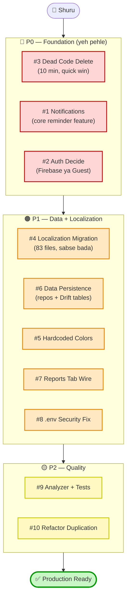
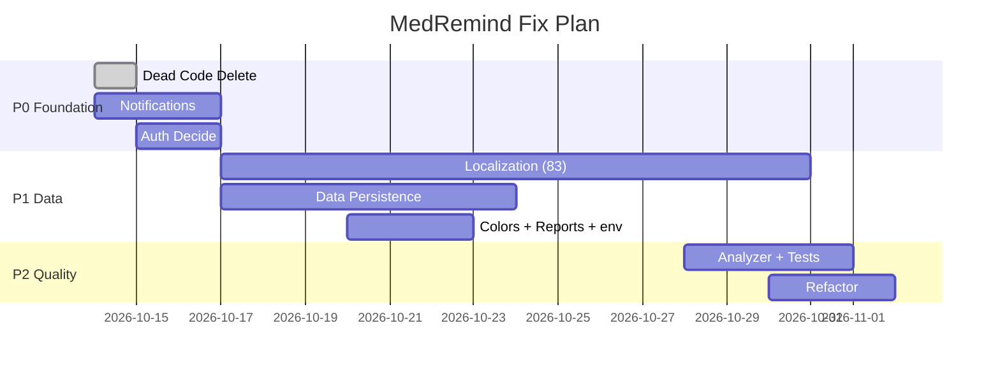

# 🗺️ KAAM ROADMAP — MedRemind (med_remind_app)

> Yeh file batati hai: **kya karna hai**, **kaise karna hai**, aur **kis order mein** (graph ke saath).
> Audit detail: `AUDIT_REPORT.md` dekho.

---

## 1. Priority Graph (kya pehle kya baad)



### Sabse simple version (text graph)

```
🚀 START
   ↓
🔴 P0:  Dead Code Delete → Notifications → Auth Decide
   ↓
🟠 P1:  Localization (83 files) ┐
        Data Persistence        ├→ ek-ek karke
        Hardcoded Colors        │
        Reports Tab             │
        .env Fix                ┘
   ↓
🟡 P2:  Analyzer + Tests → Refactor Duplication
   ↓
✅ PRODUCTION READY
```

---

## 2. Progress Graph (% wise)

```
Dead Code Delete     ████████████████████ 100%  ✅ (karna hai - quick)
Navigation fix       ████████████████████ 100%  ✅ DONE
New Screens (paywall)████████████████████ 100%  ✅ DONE
Localization infra   ████████████████████ 100%  ✅ DONE
Notifications        ░░░░░░░░░░░░░░░░░░░░   0%  ❌
Auth (real)          ░░░░░░░░░░░░░░░░░░░░   0%  ❌
Localization migrate ████░░░░░░░░░░░░░░░░  18%  ⚠️ (19/102 files)
Data Persistence     ███░░░░░░░░░░░░░░░░░  15%  ⚠️ (4 resources)
Hardcoded Colors     ██████████████░░░░░░  70%  ⚠️
Tests                ██░░░░░░░░░░░░░░░░░░  10%  ⚠️ (3 smoke)
Analyzer             ████████████████░░░░  90%  ⚠️ (15 issues)
```

---

## 3. Task List (kya + kaise)

### 🔴 P0 — Foundation

| # | Kaam | Kya | Kaise (steps) | Kitna time |
|---|------|-----|---------------|-----------|
| 3 | **Dead Code Delete** | Splash, create_account, health_profile, app_theme, community delete | 1. Yeh files delete karo.<br/>2. `flutter analyze` → 0 errors confirm.<br/>3. Onboarding chain bhi hatao (agar guest mode). | 10 min |
| 1 | **Notifications** | Reminder feature add | 1. `pubspec.yaml`: `flutter_local_notifications` add → `flutter pub get`.<br/>2. `core/notifications/notification_service.dart` banao (init, permission, `zonedSchedule`).<br/>3. `AndroidManifest.xml` mein exact-alarm + notification perm.<br/>4. `DoseRepository` se har dose ka schedule register karo.<br/>5. `main.dart` mein `NotificationService.init()`. | 1-2 din |
| 2 | **Auth Decide** | Fake auth fix | **Option A (Firebase):** `firebase_auth`+`firebase_core` add → login/signup real → `main.dart` mein auth gate.<br/>**Option B (Guest):** auth+onboarding screens delete, seedha Home. | 1 din |

### 🟠 P1 — Data + Localization

| # | Kaam | Kya | Kaise (steps) | Kitna time |
|---|------|-----|---------------|-----------|
| 4 | **Localization Migration** | 83 files hardcoded English | Per screen:<br/>1. ARB keys add karo `lib/l10n/app_{en,es,fr,ar,hi}.arb` (en mein `@key` metadata).<br/>2. `flutter gen-l10n`.<br/>3. Screen + `*_data.dart` mein `AppLocalizations.of(context)` use karo.<br/>4. `flutter analyze lib` → 0 errors → hot restart. | ~1 screen/30min |
| 6 | **Data Persistence** | Doses, vitals, adherence, inventory, refills, appointments memory-only | 1. Drift `AppDatabase` mein tables verify/add karo.<br/>2. Har feature ka `*_repository.dart` + `local_*_repository.dart` banao (meds pattern copy).<br/>3. Screens ko repos pe shift karo. | 2-3 din |
| 5 | **Hardcoded Colors** | Hex colors AppColors ke bahar | 1. Naye constants `core/constants/app_colors.dart` mein daalo.<br/>2. `member_permissions_screen` (3), `social_icons` (1), aur ~47 `Colors.white/black` replace karo. | 2-3 ghante |
| 7 | **Reports Tab** | Placeholder hai | `main_shell.dart:57` ka `_PlaceholderTab` hatao → `ReportsScreen` wire karo (report_preview files use karke). | 2-3 ghante |
| 8 | **.env Fix** | Secret + build risk | 1. `pubspec.yaml` assets se `.env` line hatao.<br/>2. `--dart-define` ya secure storage se load karo. | 1 ghanta |

### 🟡 P2 — Quality

| # | Kaam | Kya | Kaise (steps) | Kitna time |
|---|------|-----|---------------|-----------|
| 9 | **Analyzer + Tests** | 15 issues + 0 tests | 1. Unused import (`add_medication_data.dart:1`), `activeColor`→`activeThumbColor` (2 jagah), `dangling_library_doc_comments` (8), `unnecessary_import` (3) fix karo.<br/>2. `test/` mein repos + OCR parser ke 10-15 unit tests likho. | 1-2 din |
| 10 | **Refactor** | Duplication | 4 dose-status enums → 1; 2 vital enums → 1; formatters/icons `utils` file mein; fake `Future.delayed` hatao; misleading copy theek karo. | 1-2 din |

---

## 4. Sprint Plan (agar team ke saath karna ho)



---

## 5. Sabse Pehle Kya? (recommendation)

```
1️⃣  Dead Code Delete   ← 10 min, sabse asaan (shuru isse)
2️⃣  Notifications       ← app ka core, sabse important
3️⃣  Localization        ← sabse bada kaam, self-paced chalte raho
    Baaki (auth, data, colors) iske saath parallel
```

**Ek line mein:** P0 (dead code + reminders + auth) nipta lo → phir localization + data persistence. Bas, app usable ban jayegi.
