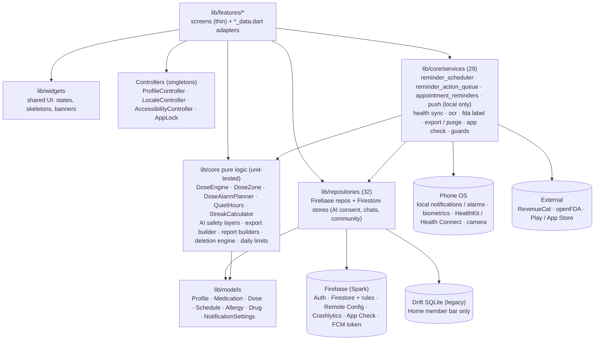
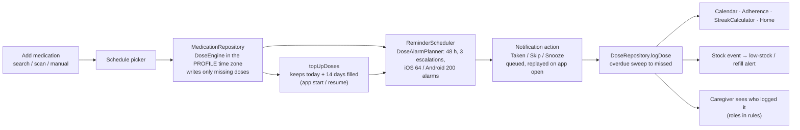

# Architecture

Status 2026-11-18, commit `727ebd7`. Flutter app (Dart SDK ^3.13) on the **Firebase Spark plan**: Auth, Firestore, Remote Config, Crashlytics, App Check (client), FCM token only. Local notifications do the reminders. RevenueCat (key pending), ML Kit OCR, openFDA labels. **No Cloud Functions are deployed.**

338 Dart files in `lib/`: `features` 127, `repositories` 32, `core` (engines, services, controllers, pure logic) the rest, `models`, `widgets`, `l10n` (5 ARBs).

## Layers

Rule of thumb for new work: put decisions in a pure class in `lib/core/<area>/` with tests, keep the screen thin, inject the data source (see `HomeDoseSource`, `DoseActionTarget`) so widget tests need no Firebase.

## Startup order (`lib/main.dart`, `AppStartup`)
0. Crashlytics handlers (scrubbed with `SafeLog`) → 1. `Firebase.initializeApp(AppConfig.firebaseOptions)` → 1.5 emulators (`USE_EMULATOR=true`) → 2. App Check (`AppCheckSetup`, enforcement off) → 2.5 Remote Config (cached, then refreshed as a startup task: kill switch / min version) → 3. `ProfileController` restore → bounded startup tasks that must not hang offline (connectivity, device token, Remote Config refresh, subscription init, preferences sync) → accessibility + locale restore → app lock (biometric) bound to the signed-in user → `ReminderScheduler.init()` + `rescheduleAll()` → `SplashScreen` → `post_auth_router` (legal re-consent, account purge if due, app blocked) → shell.

Run flavors: `--dart-define=ENV=staging|prod`, `--dart-define=USE_EMULATOR=true`. Default = staging. A fresh clone needs `firebase_options_prod.dart` (gitignored).

## Core loop (works end to end on Spark)

Quiet hours move only appointment reminders (`QuietHours`); the person's own dose reminders are never delayed. Lock-screen text hides medicine names by default (`NotificationPrivacy`).

## Trust model (rules, not UI)
Roles live in `profiles/{pid}`: owner, caregiver (+ `editMedications`, `logDoses`), viewer. Rules decide every read, list and write (443 tests, 0 probe gaps). Health data stays under `profiles/{pid}/…`, never under `users/{uid}`. Clients cannot change roles; only the self-leave is allowed. Daily limits are enforced in rules. Details: [firebase-map.md](firebase-map.md).

## Two repository styles (known duplication)
- **Firebase** impls in `lib/repositories/*` (the live path) and the Firestore stores for newer modules (AI consent, chats, community).
- **Legacy local Drift** in `lib/core/{medications,members,profile}/local_*`, `lib/core/database`: only `LocalMemberRepository` (Home member bar) is still used. Interfaces with the same name exist in `lib/core/*` and `lib/repositories/*` (e.g. `dose_repository.dart`); four files are confirmed dead (see modules-progress "Tech debt").

## Tests
76 Flutter test files (1094 tests: unit, widget), 15 emulator integration files (real repositories + real rules, real OS alarms), 443 rules tests (jest) + rules probe (0 gaps). CI runs the rules tests; the Flutter and integration tests are run by hand (commands in HANDOFF section 2).

## Directory sizes
| Area | Files |
|------|-------|
| `lib/features/*` | 127 (meds 39, settings 29, community 13, home 13, profile 10, onboarding 6, assistant 5, calendar 5, auth 3, doctors 2, reports 2) |
| `lib/repositories` | 32 |
| `lib/core/services` | 29 |
| `lib/core` (all) | engines, controllers, pure logic for ai / community / export / reports / vitals / reminders / subscription |
| `lib/l10n` | 5 ARBs (en, hi 993 keys; es, fr, ar 959) |
| tests | 76 Flutter + 15 integration + 2 jest files |
