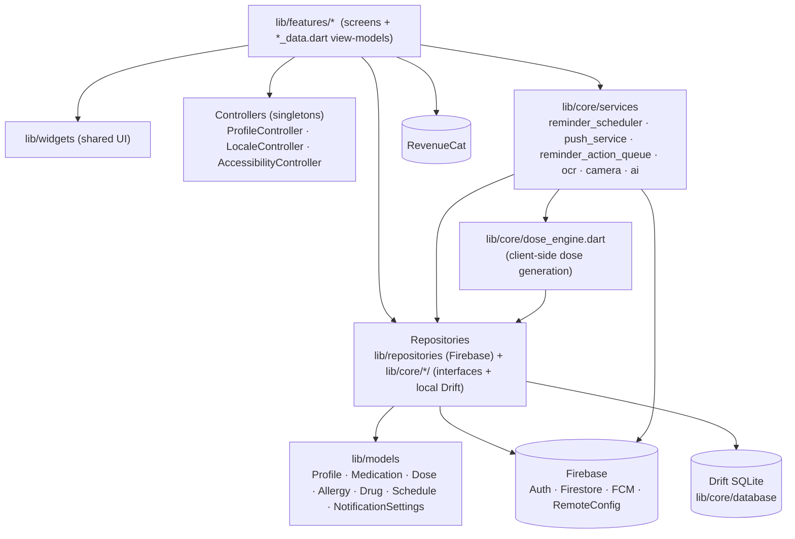
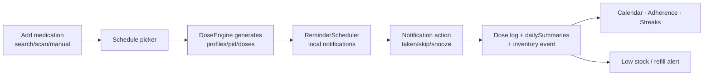

# Architecture

Flutter app (Dart SDK ^3.13) · Firebase (Auth, Firestore, Messaging, Remote Config, Crashlytics, App Check, Functions) · Drift/SQLite local DB · RevenueCat · ML Kit OCR.

## Layers

## Startup order (`lib/main.dart`)
0. Crashlytics handlers → 1. `Firebase.initializeApp(AppConfig.firebaseOptions)` → 1.5 emulators (`USE_EMULATOR=true`: Firestore 8080, Auth 9099, Functions 5001)
→ 2. App Check (enforcement off) → 2.5 Remote Config → 3. `.env` (AI keys, optional) → 4. `ProfileController` restore → then reminder scheduler / push / subscription / locale / accessibility → `SplashScreen`.

Run flavors: `--dart-define=ENV=staging|prod`, `--dart-define=USE_EMULATOR=true`. Default = staging.

## Core loop (what works end-to-end)

## Two repository styles (known duplication)
- **Firebase** impls in `lib/repositories/firebase_*_repository.dart` (auth, profile, medication, dose, inventory, subscription, caregiver-stub).
- **Local Drift** impls in `lib/core/{medications,members,profile}/local_*` — legacy pre-Firebase path. Interfaces are duplicated between `lib/core/*` and `lib/repositories/*` (e.g. `dose_repository.dart` exists in both). **Decide and consolidate** — see modules-progress "Tech debt".

## Directory sizes (approx.)
| Area | Files |
|------|-------|
| `lib/features/*` | ~150 (meds ≈ 45, settings ≈ 30, home ≈ 11, calendar 5, profile 10, assistant 5, auth 3, onboarding 3, doctors 3, reports 2, community 2) |
| `lib/repositories` | 17 |
| `lib/core` | ~30 |
| `lib/l10n` | 5 ARBs (en, es, fr, ar, hi) |
| tests | 3 Flutter smoke + 1 rules suite (26 cases) |
